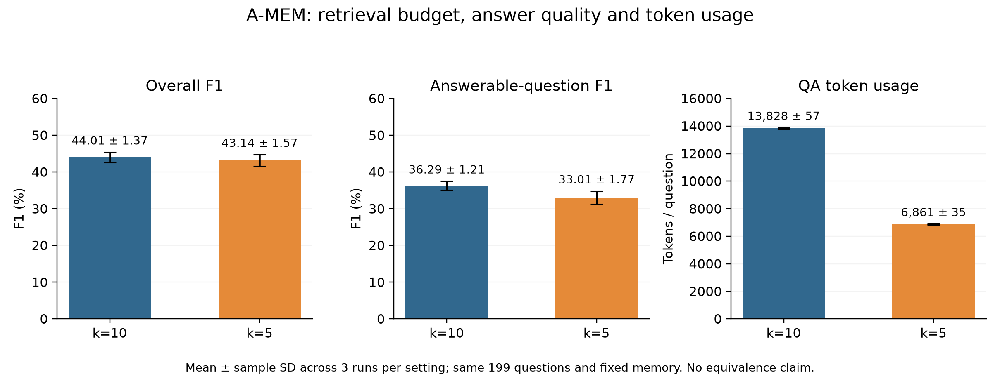

# Retrieval Quantity, Answer Quality and Operating Cost in A-MEM

FTEC5660 Reproducibility Work

**Name:** [YOUR NAME]
**Student ID:** [YOUR STUDENT ID]

> English report draft based on measured outputs. Add personal details, review, export to PDF, and verify the maximum of ten pages after typesetting.

## Abstract

This work partially reproduces the A-MEM memory-question-answering workflow using the authors' repository, DeepSeek Flash, and a fixed LoCoMo subset. The controlled modification reduces the answer-stage retrieval parameter from k=10 to k=5. Both conditions reuse the same 419-note memory and answer the same 199 questions in three rounds. Overall F1 is 44.01 +/- 1.37% for k=10 and 43.14 +/- 1.57% for k=5. The lower setting reduces QA tokens by 50.38% on average, while answerable-question F1 decreases by 3.28 percentage points. Case analysis identifies missing details, person-attribution errors and lexical-scoring limitations. These observations describe a quality-resource trade-off within this configuration, not lossless reduction or a globally optimal retrieval setting.

## 1. Project and reproduction target

A-MEM manages memory for LLM agents. It constructs notes containing interaction content, timestamps, keywords, tags and contextual descriptions, links related notes and evolves memory as new information arrives. Questions are answered using retrieved memory [1]. DeepSeek provides the language-model capability here. No model weights were trained or updated.

The reproduction target is the runnable memory-construction, linking/evolution, retrieval and evaluation workflow on a meaningful subset of the authors' conversational QA task. I produce measured outputs and compare them with the paper under explicitly different conditions. I do not rerun every comparison method or validate the paper's complete superiority claim.

The modification asks: **With the model, questions, stored memory and scoring held fixed, how does reducing the answer-stage retrieval parameter affect quality and API resource use?**

## 2. Environment and implementation

| Item | Configuration |
|---|---|
| Authors' repository | https://github.com/WujiangXu/A-mem |
| My fork | https://github.com/crescentIsland/A-mem |
| Starting upstream commit | `f9a173dec325d84fcc97e7828775c7b241c33466` |
| Environment | Windows, Python 3.12.0, PyTorch 2.15.0+cpu; no CUDA |
| Dependencies | Project-local `.venv`; exact versions in `requirements-lock.txt` |
| Evaluation | Current upstream `test_advanced_robust.py`, using plain-text parsing |
| Model / endpoint | `deepseek-flash` / `https://api.deepseek.com` |
| Decoding | Thinking disabled; maximum 1,000 output tokens; ordinary-answer temperature 0.7, category-five temperature 0.5; top_p not explicitly supplied |
| Embeddings | `all-MiniLM-L6-v2`, 384 dimensions |

Credentials stay in the local `.env`. The model and robust interface are shared adaptations, not treatment differences between k conditions. Results are not directly comparable with the original paper because the LLM, evaluation path and data coverage differ. The API model identifier is recorded, but the provider alias does not pin local weights [2].

## 3. Data and design

The repository's `data/locomo10.json` contains ten conversations and 1,986 questions. I select the first complete conversation: 19 sessions, 419 utterances and 199 questions. This is a fixed subset, not a random sample of independent questions. It includes 32 multi-hop, 37 temporal, 13 open-domain, 70 single-hop and 47 adversarial/unanswerable questions.

Memory is constructed once and reused, with file SHA256 checks before and after repeated runs. The main treatment is `retrieve_k=10` versus `retrieve_k=5`. The implementation also expands linked neighbors, so k is not exactly the number of distinct notes in the final context.

| Round | Execution order | Questions per setting |
|---|---|---:|
| 1 | k=10, then k=5 | 199 |
| 2 | k=5, then k=10 | 199 |
| 3 | k=10, then k=5 | 199 |

Seed 42 controls category-five answer-option ordering, not deterministic remote-model generation. The rounds measure repeated QA variation under fixed memory, rather than three independent memory builds. There are 199 unique questions, not 1,194 different questions. Category five uses the current corrected unanswerable reference.

## 4. Metrics and cost

Quality uses the repository's F1 and BLEU-1 implementations, supplemented by Exact Match and category breakdowns. F1 uses unique token sets after simple tokenization. It is lexical overlap, not the proportion of questions answered correctly. Values are means +/- sample standard deviations of three run-level measurements; F1 standard deviations are in percentage points.

Let A be the unique prediction-token set, B the unique reference-token set, and C=A∩B. The implemented score is:

$$P=\frac{|C|}{|A|},\qquad R=\frac{|C|}{|B|},\qquad F_1=\frac{2PR}{P+R}=\frac{2|C|}{|A|+|B|}.$$

Empty sets or zero overlap receive zero. For reference `4 years` and prediction `4`, precision is 1, recall is 0.5 and F1 is approximately 0.667. Category five uses `Not mentioned in the conversation` as its corrected reference; its reported F1 remains lexical overlap rather than a direct abstention-accuracy percentage.

**QA tokens per question** sum input and output tokens for keyword generation and answer generation, divided by 199. Memory-construction usage is separate, avoiding an unfair comparison between the first run building memory and later runs reusing it.

API seconds per question sum successful-request durations and divide by 199. They exclude local retrieval, scoring, failed attempts and backoff: this is not end-to-end runtime. Estimated charges apply cache-hit input, cache-miss input and output quantities to the corresponding official rates [3]. These are estimates, not verified bills. Cache warming and order affect charges and latency; tokens provide the more direct resource comparison.

## 5. Results

| Metric: mean +/- sample SD | k=10 | k=5 |
|---|---:|---:|
| Overall F1 (%) | 44.01 +/- 1.37 | 43.14 +/- 1.57 |
| BLEU-1 (%) | 38.82 +/- 1.23 | 37.96 +/- 0.94 |
| Exact Match (%) | 22.61 +/- 1.01 | 23.28 +/- 1.16 |
| Answerable-question F1 (%) | 36.29 +/- 1.21 | 33.01 +/- 1.77 |
| Unanswerable-question F1 (%) | 68.98 +/- 2.13 | 75.92 +/- 1.31 |
| QA tokens/question | 13,827.8 +/- 57.0 | 6,861.2 +/- 35.4 |
| Successful API seconds/question | 1.895 +/- 0.059 | 1.726 +/- 0.055 |

| Round | Overall F1: k=5 minus k=10 (pp) | Answerable F1 difference (pp) | Token reduction |
|---|---:|---:|---:|
| 1 | -0.24 | -2.29 | 50.57% |
| 2 | -1.42 | -3.70 | 50.17% |
| 3 | -0.92 | -3.84 | 50.40% |

All rounds show approximately halved tokens and lower overall and answerable F1 at k=5. The mean paired overall difference is -0.86 +/- 0.59 percentage points; the answerable difference is -3.28 +/- 0.86 points. Paired token reduction is 50.38 +/- 0.20%. These are descriptive measurements, not significance or equivalence tests. Exact Match moves differently from F1, illustrating that the metrics are not interchangeable.

## 6. Authors' results as a contextual reference

Paper Table 1 reports GPT-4o-mini + A-MEM results; Appendix A.5 specifies category-dependent k=40 or 50. The following is contextual: model, subset, prompts and scoring conditions differ, so gaps cannot be attributed to one factor [1].

| Category | Authors' k | Authors' F1 (%) | Our k=10 mean F1 (%) | Our k=5 mean F1 (%) |
|---|---:|---:|---:|---:|
| Multi-hop | 40 | 27.02 | 30.29 | 27.60 |
| Temporal | 40 | 45.85 | 27.70 | 25.50 |
| Open-domain | 50 | 12.14 | 13.80 | 11.23 |
| Single-hop | 50 | 44.65 | 47.73 | 43.50 |

Category five is separate because of corrected scoring. Figure 3 compares k=10–50 with GPT-4o-mini; our k=5/10 DeepSeek comparison is a lower-budget extension, not a reproduction of that full curve or its optimum.

## 7. Cases and debugging diary

**Detail coverage.** For “How long has Caroline had her current group of friends for?”, k=10 answers `4 years` in all rounds; k=5 does not give the correct duration. The inspected third-round k=10 context contains the direct statement; k=5 lacks it. This is consistent with missing useful evidence, although query generation and answer sampling remain potential influences.

**Person attribution.** For the unanswerable question about why Melanie selected an adoption agency, k=10 repeatedly applies Caroline's reason; k=5 correctly abstains. Both inspected contexts contain Caroline's information. Additional context did not ensure correct attribution.

**Scoring limits.** For a reference of `self-care is important`, k=5 returns `taking care of our minds`, receiving lexical F1=0 despite semantic relatedness. A score decrease is not always a factual failure. Full examples are in `ERROR_CASE_ANALYSIS.md`.

Blockers included Windows Git/environment permissions, NLTK proxy downloads, a stalled BERTScore-model download, isolation of smoke-test and full-data caches, and DeepSeek HTTP 402 insufficient balance. In round-two k=10, 102 saved answers were recovered from the original log and rescored offline with unchanged metrics. All metrics matched exactly for 66 identical prediction/reference cases in prior runs. Execution resumed at question 103 without regenerating the prefix. Atomic per-question checkpoints were added and eight local checkpoint tests passed. The interruption is disclosed rather than hidden as an uninterrupted run.

## 8. Conclusions and limitations

The authors' memory-construction, linking/evolution, retrieval-QA and scoring workflow runs on this environment and subset. The comparison shows roughly halved QA tokens at lower k, with an observed quality cost on some categories. It does not establish lossless reduction or a globally optimal k.

Limitations include one conversation, repeated QA rather than independent memory builds, 33 truncated outputs during the shared memory build, model/prompt/category-five differences, lexical-scoring sensitivity, and provider-cache/load effects on charges and latency. Three rounds do not establish statistical significance.

I recommend fixing and fingerprinting memory, separating construction and QA costs, and inspecting category scores and individual answers. The limited research question has descriptive results; more k values are not required for this submission's chosen scope.

## References and evidence

1. Xu et al. *A-MEM: Agentic Memory for LLM Agents*, v11: https://arxiv.org/html/2502.12110v11 . Evaluation repository: https://github.com/WujiangXu/A-mem .
2. DeepSeek API and thinking mode: https://api-docs.deepseek.com/ ; https://api-docs.deepseek.com/guides/thinking_mode/ .
3. Official pricing, checked 2026-11-07: https://api-docs.deepseek.com/quick_start/pricing/ .

Summary: `submission/measurements.json`; six measured answer sets: `submission/data/`; per-run table: `submission/run-metrics.csv`; full results: `THREE_ROUND_RESULTS.md`. The fork provides the implementation changes, environment instructions and measured evidence in separate commits.
